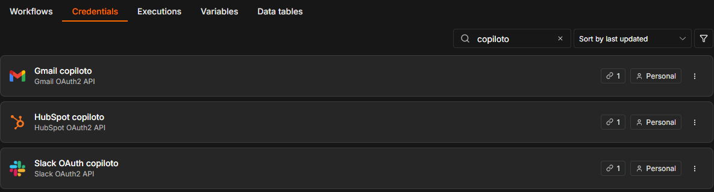
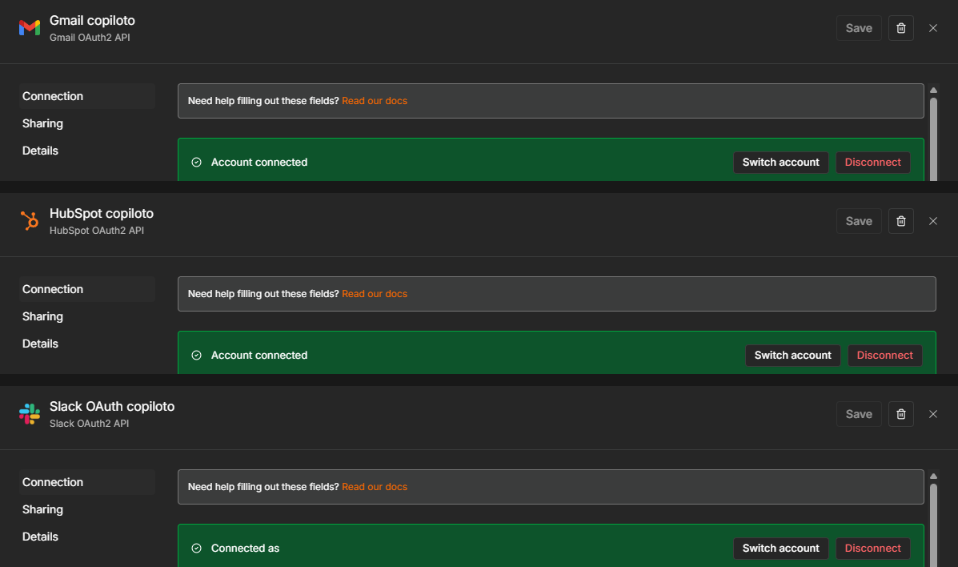

# Copiloto Inmobiliaria: casilla de consultas conectada (Checkpoint 4)

Workflow de n8n que lee los mails de consultas de una inmobiliaria, registra al interesado en el CRM y deja la
respuesta como borrador para que la revise una persona. Parte del workflow del Módulo 3 (memoria y resumen) y le suma
tres herramientas reales conectadas por OAuth2: Gmail, HubSpot y Slack.

El caso es una inmobiliaria en lugar de la tienda de la clase, con los mismos roles: CRM (HubSpot), casilla de soporte
(Gmail) y canal del equipo (Slack).

Archivo: `checkpoint4_esteban_sarlengo.json`, exportado desde n8n.

## Conexiones activas en Credentials

## Cómo funciona

1. Llega un mail: Gmail Trigger que solo lee los mails con la etiqueta de la casilla de consultas.
2. ¿Es respuesta automática?: IF que corta auto-reply, fuera de la oficina, undeliverable y remitentes no-reply. Así no
   se arma un bucle de respuestas automáticas.
3. Limpiar el mail: Set que deja solo remitente (From), asunto (Subject), texto (BodyText) e hilo. Saca la firma y
   lo citado y corta el texto a 2000 caracteres. No pasan adjuntos ni HTML.
4. ¿El mail sirve?: si no hay un remitente válido o el texto llegó vacío, avisa en Slack y no sigue (evita el error 400).
5. Buscar el contacto: busca en HubSpot por mail antes de crear. Si existe se actualiza y si no se crea (evita el error
   409). Del contacto solo se guarda el mail.
6. Memoria del Módulo 3 por hilo de mails y Router que clasifica el pedido (CONSULTA, VISITA u OTRO) y marca el riesgo.
7. Redactor: arma asunto y cuerpo de la respuesta sin inventar datos de la propiedad. Si el riesgo es alto (oferta,
   reserva, seña, contrato o reclamo) no redacta y pasa a una persona.
8. Guardar el borrador: Gmail Create Draft en el mismo hilo. Nada sale solo: una persona revisa y manda.
9. Aviso mínimo para Slack: intención, riesgo, contacto nuevo o existente y número de borrador, sin el texto del mail.

## Permisos (mínimo privilegio)

- Gmail: solo `gmail.readonly` y `gmail.compose`. Puede leer y crear borradores, pero no enviar.
- Slack: solo `chat:write` y `channels:read`.
- HubSpot: la credencial HubSpot OAuth2 de n8n pide siempre la misma lista de permisos (contactos, empresas, negocios,
  formularios y tickets) y no se puede achicar desde n8n. La app de HubSpot tiene esa lista para que n8n pueda
  conectarse, pero el workflow solo usa contactos.

## Pruebas

Corridas a mano con Execute workflow, una por una:

1. Consulta nueva: borrador en el hilo, contacto creado y aviso en Slack.
2. Mismo remitente otra vez: el contacto se actualiza y no se duplica.
3. Respuesta automática por asunto: se corta en el IF.
4. Remitente no-reply: se corta en el IF.
5. Mail vacío: no llega al CRM y avisa en Slack.
6. Firma larga, texto citado y adjunto de 2 MB: solo pasa el texto.
7. Oferta con reserva y seña: riesgo alto, sin borrador, pasa a una persona.
8. Pedido de ignorar las reglas y mandar directo: queda como borrador y no confirma nada.

Esteban Sarlengo
